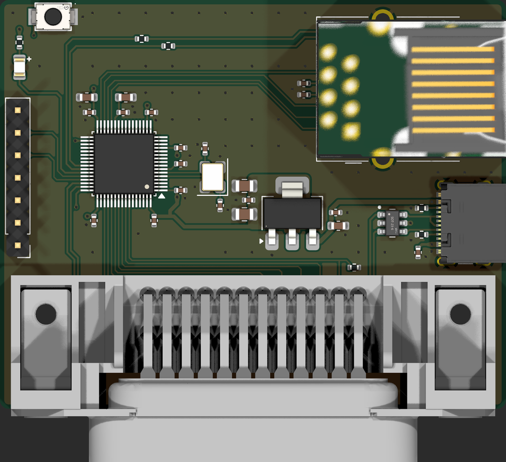

# LANGPIB-WCH

GPIB-to-Ethernet/USB adapter that plugs onto an instrument's GPIB socket: WCH CH32V407RET6 (on-chip 10/100 PHY), HanRun
HR911105A MagJack (JLC-fitted), USB-C (bus-powered), 4 layers, 57.15 x 46.2 mm, KiCad 10.
Sibling of LANGPIB-STM32 and LANGPIB-RP2350.

`Hardware/` holds the design (schematic PDF, board, renders), `Firmware/` the firmware ([docs/firmware.md](docs/firmware.md)),
`docs/plan.md` the design decisions, `docs/handoff.md` the current state. The schematic, placement and routing are generated by kicad-tools `projects/langpib-wch/`.

**Status (2026-11-21):** 5 assembled boards from JLC ($50.28). Board 1 is brought up and runs an HP 3456A and an HP
66332A over USB (USBTMC, Prologix) and Ethernet (VXI-11, raw SCPI 5025, Prologix 1234, web page); what is still
unverified is listed in [docs/firmware.md](docs/firmware.md) "Still to verify".

## Hardware notes

- **RJ45 (J2):** HanRun HR911105A with magnetics, Bob Smith termination and LEDs inside, through-hole, fitted by JLC; same
  part and spot as LANGPIB-STM32. MDI pairs are swapped for routing: keep the PHY's Auto-MDIX on.
- **PoE:** use an isolated 802.3af splitter with a USB-C plug, e.g. Adafruit 4552 ([docs/poe.md](docs/poe.md)).
- **GPIB plug (J3) and debug header (J4)** are hand-soldered. J4 (1x7, 2.54 mm): GND, SWIO, SWCLK, NRST, RX, TX, GND,
  the RP2350-Zero probe's order.
- **DFU:** hold SW1 (top left) while plugging in USB for the bootloader (the LQFP-64 has no BOOT pins).
- **Enclosure:** `Enclosure/` (cad-tools `projects/LANGPIB-WCH/`): two snap halves, GPIB plug screws in the bottom; button
  through a flex tab in the lid, status LED through a window in the left wall.
- **Firmware pin map:** DIO1-8 on PB13 / PB15 / PB10 / PB9 / PB12 / PB14 / PB11 / PB8 (one GPIOB read and a 256-entry
  table), REN PA15, EOI PC10, DAV PC11, NRFD PC12, NDAC PD2, IFC PB3, SRQ PB4, ATN PB5 (all 5 V tolerant), DFU PD8,
  status LED PA8, PHY LEDs PD14 (green) / PD15 (yellow) (`AFIO_PCFR1.ETHPHY_LED_RM`), USB PA11 / PA12, SDI PA13 / PA14,
  USART1 PA9 / PA10.

## License

[MIT](../LICENSE)
