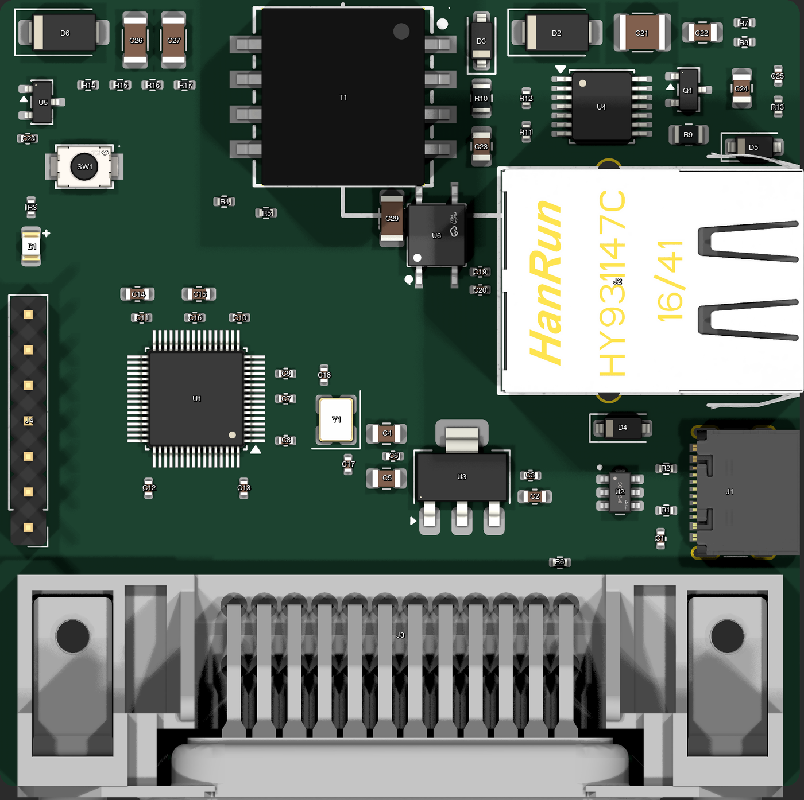

# LANGPIB-WCH: PoE

## Now: an external splitter (user, 2026-11-04)

For PoE on the current board, use an **isolated 802.3af splitter with a USB-C plug**: [Adafruit 4552](https://www.adafruit.com/product/4552)
(isolated, 5 V 2 A, 10/100, $14.95, $13.46 at 10+) is a good choice. Its short USB-C and Ethernet leads go to J1 and J2; the
board is unchanged. Avoid splitters that don't state isolation (see **Isolation**).

A DIY splitter board (HY931147C back to back with an HR911105A, the power stage below, USB-C out) was costed and
**dropped**: about $16.88 per unit at 5 ($84 order), $11.79 at 10, $8.79 at 30, plus cables and a case, so it only beats
the Adafruit part at around 30 units.

## Isolation

The board's GND is GPIB logic ground, which most instruments tie to the earthed chassis (and the USB host's ground is
often earthed too). A non-isolated PD would tie the PoE return to earth: it fails 802.3's 1500 V isolation, and earth
currents can flow in the PoE return (ground loops, PSE overcurrent or detection faults). A Y capacitor on the shield
doesn't help: the conflict is on GND itself, which carries DC. So PoE, on board or in a splitter, must be isolated.

## Onboard PoE (research, parked 2026-11-04)

**Status:** research only, not planned for a board revision (user, 2026-11-04). Everything below is the starting point
if it is picked up again: parts, circuit choices, mockup and cost. The open items list what is still missing.

### Front end
**J2 -> HanRun HY931147C** (C91754, $1.69 @100, 5959 in stock, THT, JLC-fitted like the HR911105A): 10/100 PoE MagJack,
802.3af, 1500 Vrms, **both bridge rectifiers inside** (data and spare pairs), PoE out on V+ P9 / V- P10, chip-side
1CT:1 + CMCs, yellow / green LEDs (11/12, 13/14). 16.1 x 21.6 x 13.95 mm, tab down. No Bob Smith termination shown.
Needs a new footprint and 3D model (pins differ from the HR911105A). Other stocked HanRun PoE jacks: kicad-tools `docs/parts.md`.

### Power stage (802.3af class 1, ~1.3 W in)
| Part | Choice | LCSC | Type |
|---|---|---|---|
| PD + flyback controller | TI TPS23753APWR (TSSOP-14) | C92115, $0.97 @100, 8.1k | extended |
| Flyback transformer | HanRun HR051067: 36-72 V in, 5 V 1.4 A, 155 uH, P : bias : S = 1 : 0.667 : 0.262, 1500 Vrms, 12.7 x 15.2 x 10.9 | C93830, $0.80, 2.2k | extended |
| Switch | FDN86246 150 V SOT-23 | C7421706, $0.19, 3.3k | extended |
| Feedback | EL357N opto + CJ431 (TL431) | C359074 / C3113 | extended / basic |
| Input TVS | SMAJ58A | C10762 | extended |
| Output rectifier | SS54 | C22452 | basic |
| Y cap across the barrier | 1 nF 2 kV 1206 | C9196 | basic |
| VBUS OR diode | B5819W | C8598 | basic |

- RDEN 24.9k, RCLS **243 R (class 1)**, RFRS 60.4k (~250 kHz, the transformer's spec point), CVB / CVC 0.1u (datasheet
  defaults). Current-sense R, VC bias, blanking, soft start and loop compensation still to be designed (TI SLVA305, EVM SLVU314).
- Why not TPS23755 (C469846, optocoupler-free, FET inside): TI tunes its primary-side regulation for 12 V and higher; at 5 V
  the output diode's drop spoils regulation. The TPS23753A with optocoupler and TL431 is TI's usual 5 V design.
- **Power OR:** the flyback output goes straight onto +5V (its rectifier blocks back-feed); VBUS feeds +5V through a
  B5819W, which also keeps PoE off the USB host. USB-only gives about 4.55 V at the AMS1117: about 1.25 V of headroom at
  200 mA, enough but slim (an LDO with lower dropout is an option).

### Layout

Mockup (2026-11-04, kicad-tools `projects/langpib-wch/poe_mock.py` on a scratch copy, no copper, no courtyard overlaps): T1 straddles
the barrier (the white silk line) with its primary side east. PoE side, east of T1: D2 TVS, C21 / C22 input, R7 / R8
detection and class resistors, U4 TPS23753A, Q1 FET, R9 sense resistor, the D3 / R10 / C23 clamp, D5 / C24 bias, and
small parts. 5 V side, top left: D6 SS54, C26 / C27, U5 CJ431, divider. U6 opto and C29 Y-cap straddle the barrier below
T1. D4 (VBUS OR diode) sits between J2 and J1. Tight: about 20 parts in 21 x 12 mm. The PHY LED traces can no longer
run across the top, so they go under the jack. The MDI pairs go round U6.

- About 22 x 20 mm, primary side included: the board grows **10 mm (57.15 x 56.2)**, like the 2026-11-03 PoE-ready
  placement (`432ae1f`). The power stage goes top right, behind J2's V+ / V- pins.
- Primary zone (V+, RTN, controller, FET, primary and bias windings) gets its own RTN pour; In1 GND / In2 +3V3 are cut
  back from it. The transformer and opto straddle the barrier, with **2 mm or more** primary-to-secondary spacing on all
  layers (a `.kicad_dru` rule) and the Y capacitor across it.
- Height: the HR051067 (10.9) is lower than the jack (13.95), so the enclosure keeps its height and only grows 10 mm in length.

### Cost (live JLC prices, 2026-11-04)
Adds 5 extended types (TPS23753A, HR051067, FET, opto, TVS) = $15.45 per order, plus about $4.30 of parts per board
(the HY931147C costs $0.88 more than the HR911105A at 5).

| Boards | Today | With PoE |
|---|---|---|
| 5 | $50.28 | ~$90 (over the $59 line) |
| 30 | - | about +$4 per board |

### Open
- Converter design per SLVA305 (RCS, VC bias, soft start, compensation); check against the HR051067's 155 uH and turns ratio.
- AMS1117 headroom on USB only (above).
- The 5-board order is over $59 with PoE assembled. Alternatives: fit PoE on fewer boards, or leave it DNP and hand-solder.
- HY931147C footprint + 3D model; enclosure 10 mm longer.
