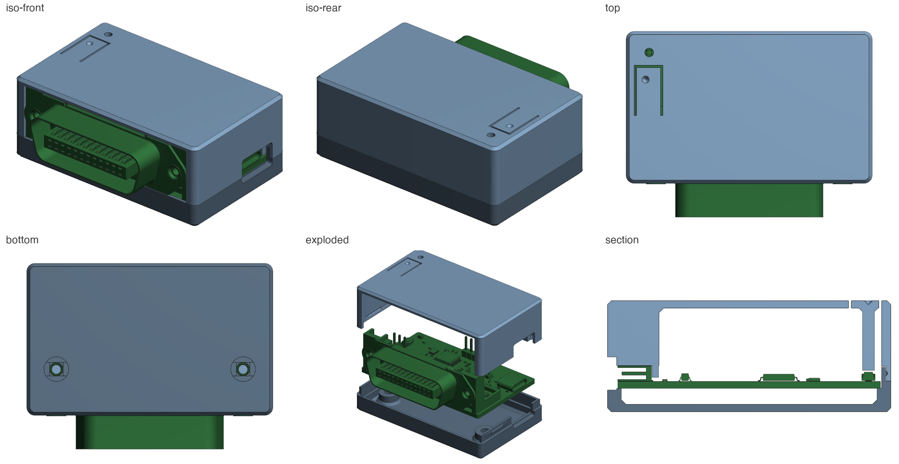

# Enclosure

Snap-fit dongle case. **Not printed yet.**

| File | Use |
|---|---|
| `bottom.3mf`, `top.3mf` | **slice these**: already in print orientation (bottom floor-down, top roof-down) |
| `*.step` | CAD, in assembly position |

## Print settings (Prusa, PETG, 0.4 mm nozzle)
| Setting | Value | Why |
|---|---|---|
| Profile | PrusaSlicer system PETG profile for your printer | temperatures, cooling, speeds |
| Layer height | 0.20 mm (first layer 0.20) | the counterbore bridge layers are modelled 0.2 thick |
| Perimeters | 4 | 2 mm walls print solid; snap lip stays strong |
| Top / bottom solid layers | 5 / 4 | |
| Infill | 20 % gyroid | little infill area; walls carry the load |
| Supports | **off** | none needed (see below) |
| Brim | off | chamfered bed edges, small parts |
| Bed | textured PEI (smooth PEI: glue stick as a release layer, PETG can bond too hard) | |
| Seam | aligned | lands on a rounded corner |

## Hardware and assembly
1. 2 x **#4-40 UNC x 5/16" pan-head** screws (J2's feet are 4-40 threaded: Norcomp hardware option 00).
2. Board into the bottom half, then the screws from below through the case and the PCB into J2's feet.
3. Press the top half on until the five snaps click. To open: pry the seam apart with a thin blade (the snaps are 45° both ways).
