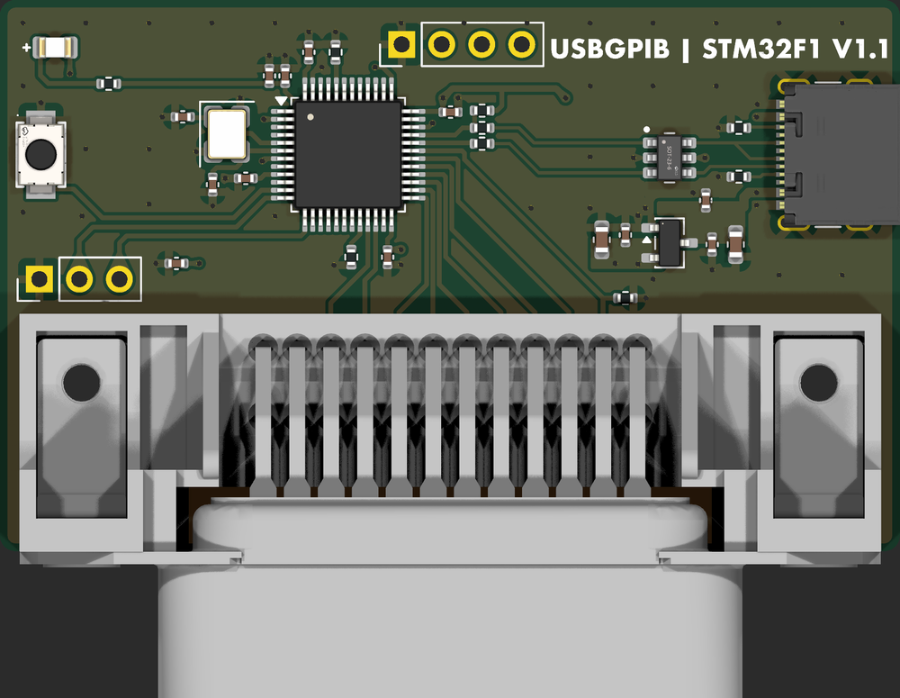
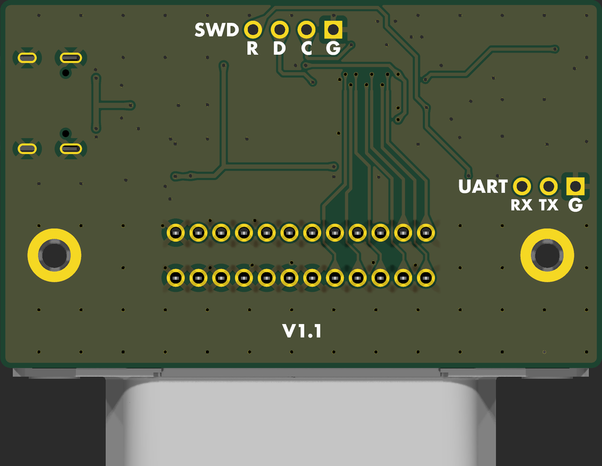

# USBGPIB-STM32

A USB to GPIB (IEEE-488) adapter: an STM32F1 port of [xyphro's UsbGpib](https://github.com/xyphro/UsbGpib). It plugs straight into an instrument's GPIB socket and shows up as a USBTMC device for VISA and as a Prologix-compatible serial port.

 

Designed in KiCad 10.

## Status

Prototype. A V1.0 board works on macOS with an HP 3456A (USBTMC and Prologix) and an HP 66332A (PyVISA). Not tested yet: Windows, Linux, NI or Keysight VISA, several instruments on one bus, bus timing on a logic analyser, the web app, the enclosure, and V1.1 boards.

The firmware uses the pid.codes test ID 1209:0001, which must be replaced before release.

## Features

- STM32F103C8T6 at 72 MHz from a 16 MHz crystal; USB 2.0 full speed (TinyUSB).
- Composite USB device: USBTMC/USB488, a serial port speaking the Prologix `++` protocol, and DFU.
- GPIB lines driven directly from the MCU's 5 V-tolerant pins in open-drain mode, no bus drivers: fine for about 5 instruments on the bus.
- USB-C with 5K1 CC pull-downs, SRV05-4 ESD protection, XC6206 3.3 V LDO.
- DFU bootloader (dapboot) entered with SW1; SWD and UART headers.
- Browser app (`web/`, Chrome or Edge): settings, bus scan, terminal, plotter capture and firmware updates.

## Connectors

| Ref | Part | Pins |
|---|---|---|
| J1 | USB-C receptacle | USB 2.0 (D+/D−), VBUS, CC1/CC2 5K1 to GND |
| J2 | Norcomp 112-024-113R001, 24-pin GPIB plug, right angle | IEEE-488 pinout; DNP, soldered by hand |
| J3 | 1×3 header, UART2 | 1 GND, 2 TX (PA2), 3 RX (PA3); 3.3 V only; DNP |
| J4 | 1×4 header, SWD | V1.1: 1 GND, 2 SWCLK, 3 SWDIO, 4 NRST. V1.0: 1 SWDIO, 2 SWCLK, 3 GND. No power; DNP |

SW1 is the DFU button (PA1 to GND), D2 the status LED (PC13).

## GPIB pin map

| Signal | GPIB pin | STM32 | | Signal | GPIB pin | STM32 |
|---|---|---|---|---|---|---|
| DIO1 | 1 | PB9 | | EOI | 5 | PB12 |
| DIO2 | 2 | PB7 | | DAV | 6 | PB13 |
| DIO3 | 3 | PB10 | | NRFD | 7 | PB14 |
| DIO4 | 4 | PB11 | | NDAC | 8 | PB15 |
| DIO5 | 13 | PB8 | | IFC | 9 | PA8 |
| DIO6 | 14 | PB6 | | SRQ | 10 | PA9 |
| DIO7 | 15 | PB4 | | ATN | 11 | PA10 |
| DIO8 | 16 | PB3 | | REN | 17 | PA15 |

GND on GPIB pins 12 and 18–24.

## Build

You need `make`, the [Arm GNU toolchain](https://developer.arm.com/downloads/-/arm-gnu-toolchain-downloads) and Node 22 (for the web app).

- macOS: `brew install --cask gcc-arm-embedded`
- Debian or Ubuntu: `sudo apt install build-essential gcc-arm-none-eabi libnewlib-arm-none-eabi`

```sh
git clone --recurse-submodules https://github.com/jlpoltrack/GPIB-Adapters.git
cd USBGPIB-STM32

make -C Firmware              # Firmware/build/usbgpib.bin
make -C Firmware bootloader   # bootloader/dapboot/src/dapboot.bin
make -C Firmware test         # host tests

cd web && npm ci && npm test && npm run build   # web/dist; npm run dev serves it locally
```

## Flash

The first flash goes over SWD (J4, ST-Link, [pyOCD](https://pyocd.io)). Later updates go over USB ([dfu-util](https://dfu-util.sourceforge.net)).

```sh
make -C Firmware flash-all    # first time: dapboot and the app
make -C Firmware dfu          # later: the running app restarts into dapboot
```

`dfu-util` may end with `unable to read DFU status` (exit 74): that is harmless, dapboot resets as it finishes.
The app embeds dapboot and rewrites it at boot when it differs, so a USB update of the app updates the bootloader too.

## Use

The adapter only appears on USB once it has found an instrument, and the USBTMC side binds to that instrument. The serial port reaches any address on the bus, e.g. `++addr 5`, then `*IDN?` and `++read eoi`. Without an instrument the LED blinks; hold SW1 while plugging in to reach dapboot.

Commands and internals: [docs/firmware.md](docs/firmware.md). Design notes: [docs/hardware.md](docs/hardware.md).

## Bill of materials

All assembled parts have LCSC numbers: [Hardware/production/bom.csv](Hardware/production/bom.csv). J2 is hand-soldered.

## Files

| Path | What |
|---|---|
| `Hardware/` | KiCad project, schematic PDF, renders; `KiCADv6/` holds the J2 symbol |
| `Hardware/production/` | generated with the [Fabrication Toolkit](https://github.com/bennymeg/Fabrication-Toolkit) plugin, ready for JLCPCB |
| `Enclosure/` | 3D-printed snap-fit case: 3MF to print, STEP for CAD |
| `Firmware/` | application firmware; shared code is in [gpib-core](../gpib-core) |
| `bootloader/dapboot/` | DFU bootloader (submodule) |
| `web/` | Web Serial / WebUSB browser app |
| `tools/` | board checks and instrument tests, below |

Tool setup: `python3 -m venv .venv`, `.venv/bin/pip install -r tools/requirements.txt`. Tools that use SWD run under pyOCD's Python.

| Tool | What |
|---|---|
| `flash_board.py` | first flash of a new board, read back and checked |
| `gpib_shorts.py` | solder-bridge test of the GPIB lines over SWD |
| `bringup.py`, `swd_rescue.py` | SWD tests on the bring-up image (`make -C Firmware flash-bringup`); recovering a board with no NRST wired |
| `usb_bench.py` | USB checks on the no-instrument image (`make -C Firmware BENCH=1 flash`) |
| `hp3456a_check.py`, `hp66332a_check.py` | end-to-end tests against those instruments |
| `bench_throughput.py` | USBTMC read throughput |
| `latency_3456a.py` | per-transfer timing of one HP 3456A reading, display on vs off, USBTMC and Prologix. Found that the meter's display refresh, not the adapter, costs ~130 ms per reading |

## License

[MIT](../LICENSE). Firmware derived from UsbGpib by Kai Gossner (MIT).
